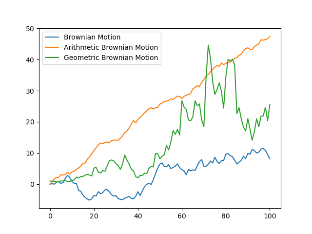

## 1. Data Layout
| Object | Definition | Shape/type |
|---|---|---|
| $`N`$ | Number of assets **including cash** | int |

**Returns are log returns:** $`r_{i,t} = \log X_{i,t} - \log X_{i,t-1}`$. Simple returns $`(X_t - X_{t-1})/X_{t-1}`$ are used only in the robustness check (Section 6). *Reason:* every Section-5 formula is derived in log prices, so known-answer tests are exact.

## 2. `Series` class
| Attribute | Definition | Shape/type |
|---|---|---|
| `T` | Total amount of time | float |
| `n` | Total number of steps | int |
|  `dt` | Time between steps | float |
| `t` | Array of times | `(n+1,)` float |

### Example Code:
```python
from gauge_arbitrage import time_series

A=time_series.Series(100, 100, seed=0)
fig, ax=plt.subplots(1,1)

ax.plot(A.t, A.bm())              # Brownian Motion (random walk)
ax.plot(A.t, A.abm(0.5,0.5,0))    # Arithmetic Brownian Motion
ax.plot(A.t, A.gbm(0.08, 0.2, 1)) # Geometric Brownian Motion
```

