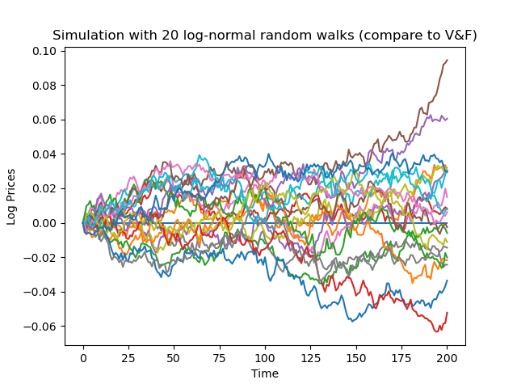
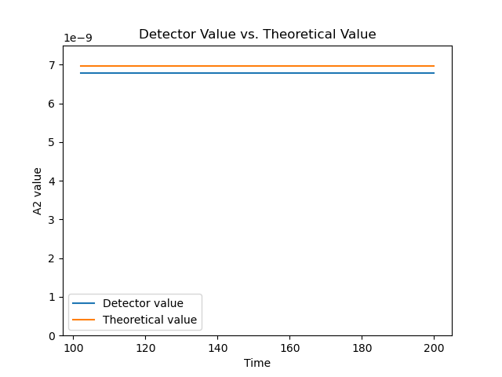

# gauge-arbitrage-theory
Vázquez and Farinelli (V&F, arXiv 0908.3043) propose a gauge-invariant measure of arbitrage ($`\alpha^A`$) and a detector for it. We want to find out what that detector responds to. Specifically, we want to know what it means mathematically (what statistic of the return process it computes), what it means financially (what market behavior makes it positive, negative, or zero), and whether it is equivalent to, or a disguised version of, something already known, such as return autocorrelation, lead-lag structure, or cointegration. We are currently in the simulation phase, and we are finding out which kinds of market behavior make V&F's arbitrage detector read positive, negative, or zero.

## Objectives
- Implement the detector from V&F and reproduce the paper's 21 asset simulation
- Run the detector on simulated market data (autocorrelation, lead-lag, cointegration)
- Derive the detector's outputs for each model and check them using Monte Carlo

## Current Results


*Figure 1: Recreation of V&F's 21 asset simulation (compare to V&F figure 1)*



*Figure 2: Recreation of V&F's detector output (compare to V&F figure 2)*

## Overview of Variables
A hat symbol above a variable (Ex. $`\hat{\alpha^A}`$) means it is an estimate for the true value.

| symbol | code | meaning |
|---|---|---|
| $`T`$ | `T` | number of steps |
| $`N`$ | `N` | number of assets (including cash) |
| $`r_t`$ | `R[t]` | log returns at step $`t`$, shape `(T, n)` |
| $`L`$ | `L` | covariance window length |
| $`k`$ | `n_dirs` | number of calm portfolios |
| $`d`$ | — | number of independent Brownian motions |
| $`\hat J^A(t)`$ | `weights` | calm portfolio $`A`$ at step $`t`$ |
| $`\hat\alpha_A`$ | `port_ret` | return of calm portfolio $`A`$ over one step (`alpha_A_hat` for `vf_series,py` only) |
| $`\hat{\mathcal{A}}^2`$ | `products` | detector value per step |
| $`\mu,\ \Gamma_0,\ \Gamma_1`$ | `moments()` | mean, covariance, lag-1 autocovariance of returns |
| $`D`$ | — | population value of the detector for a fixed $`J`$: $`(J^\top\mu)^2 + J^\top\Gamma_1 J`$ |

## Methods
### `run_detector()` algorithm

The main detector algorithm is (Eq. 90):

```math
\hat{\mathcal{A}}^2(t+1) = \sum_A \hat\alpha_A(t)\,\hat\alpha_A(t+1) 
```

Detector variables (for each step $`t`$):

1. $`\hat\Omega(t)`$ = sample covariance of `R[t-L+1 : t+1]`: V&F Eq. 93
2. $`\hat G(t) = P\,\hat\Omega(t)\,P`$ with $`P = I - \mathbf{1}\mathbf{1}^\top/n`$: Eq. 85
3. $`\hat J^A(t)`$, $`A = 1..k`$: eigenvectors of $`\hat G`$ with the $`k`$ smallest
   eigenvalues, computed on the zero-sum plane, sign-aligned to the previous
   window: Eqs. 86–88, Appendix A
4. $`\hat\alpha_A(t+1) = \hat J^A(t)^\top r_{t+1}`$: Eq. 89

### Theoretical detector value $`D`$

We propose a formula for the theoretical detector value (summed over the calm directions):

```math
D=\sum_A (J^A)^{\top}(\Gamma_1+\mu\mu^{\top})J^A
```
where
1. $`J^A`$ are the calm portfolios
2. $`\Gamma_1`$: lag-1 autocovariance matrix
3. $`\mu`$: mean return vector

Thus, $`D`$ has a drift part $`(J^\top\mu)^2`$ and an autocovariance part $`J^\top\Gamma_1 J`$

## Quickstart
Run in terminal:
```bash
git clone https://github.com/<you>/gauge-arbitrage-theory.git
cd gauge-arbitrage-theory
pip install -e .          
```

Python example:
```python
from gauge_arbitrage.vf import detector, vf_series
import numpy as np

T, n, d, N = 200, 200, 18, 20

rng=np.random.default_rng(seed=0)

beta_a=rng.uniform(low=-0.0001, high=0.0001, size=(d))                                        
sigma=np.insert(rng.uniform(low=-0.001, high=0.001, size=(N, d)),0,  np.zeros(d), axis=0)   
alpha_A=rng.uniform(low=-0.0001, high=0.0001, size=(2))  
            
series = vf_series.Vf_series(T, n)
Z = rng.standard_normal((T, d)) 
X=series.X_mu_43(sigma, beta_a, alpha_A, 1, Z)

R = detector.calc_R(X)
signals = detector.run_detector(R, L=100, n_dirs=2, use_cash=False) # Cash already included
```

## Layout
```
gauge_arbitrage_theory/
├── README.md           
├── walkthrough.ipynb                 Project walkthrough
├── docs/
│   ├── figures/                      Output plots
│   ├── DEFINITIONS.md                Shared definitions
│   ├── STATUS.md                     Progress tracker
│   ├── project_overview.md           Reference doc
│   └── simulation_phase_overview.md  Reference for simulation phase
├── notebooks/                
├── results/                  Simulation phase results
├── src/gauge_arbitrage
│   ├── time_series.py        Creates time series using NumPy
│   └── vf/
│   │  ├── detector.py        V&F's algorithm (section 4) used in the simulations
│   │  ├── predict.py         Prediction calculator
│   │  └── vf_series.py       V&F's 21 asset simulation random walks (Fig. 1 in V&F)
```


Full conventions, shapes and known-answer values: [`DEFINITIONS.md`](docs/DEFINITIONS.md).
Progress and status of each claim: [`STATUS.md`](docs/STATUS.md).
